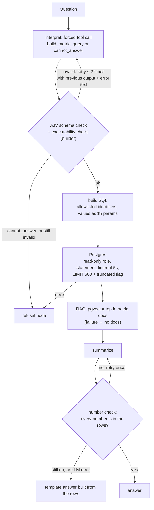

# Product Analytics AI Agent (Node.js, TypeScript)

A demo, not a production service: it answers product-analytics questions ("conversion from sign_up to purchase for the last 7 days by country") over a synthetic Postgres `events` table.
The point of the repo is the guardrails around the two LLM calls: where the model fails, and the code and tests that catch it.

## Flow



The graph is LangGraph (`Annotation.Root` state, conditional edges to the refusal node) in `graph/`. Services are injected, so every step can be tested without an LLM or a database.

## Quickstart

```bash
npm install
cp .env.example .env          # set OPENROUTER_API_KEY
docker compose up -d          # Postgres 16 + pgvector on 127.0.0.1:5432 (DB_PORT=55432 docker compose up -d if taken; update .env)
npm run migrate && npm run seed && npm run index
npm run ask -- "Покажи конверсию из sign_up в purchase за последние 7 дней по странам"
```

Without an API key: `npm test` and `npm run typecheck` need neither the key nor the database (the tests use a fake LLM), and `npx tsx scripts/testRunAnalytics.ts` runs a sample query through the builder and the read-only role.

## ADR: why not text-to-SQL

- **Context:** the model's output ends up executed against a database, and the model is the least reliable part of the system.
- **Decision:** the model fills a small typed object (metric, events, `group_by`, days) via a tool call; `buildSqlFromParsedQuery` writes the SQL.
- **Why:** the surface to validate is a JSON Schema with enums instead of all of SQL. Invalid output is detected deterministically and fed back to the model. The funnel semantics (event order, one country per user) live in reviewed, tested code, not in a sampled completion.
- **Cost:** every new metric or column is a code change, and anything outside the schema gets `cannot_answer`. That is intended.
- **Defense in depth:** the builder re-checks identifiers itself, and the query runs as a read-only role with a timeout, in case both checks above ever miss something.

## Where the model fails and how it is caught

| Where the model fails | How it is caught | File | Test |
|---|---|---|---|
| Tool arguments are not JSON, or there is no tool call at all | `tool_choice: 'required'`, `JSON.parse` in `parseChoice`, retry with the previous output + error text, at most 2 retries | `services/interpretUserQuery.ts` | `test/interpret.test.ts`: "garbage -> schema-invalid -> valid…", "three garbage outputs throw" |
| Output cut off by `max_tokens` | `finish_reason === 'length'` is treated as a failure and retried | `services/interpretUserQuery.ts`, `services/summarizeAnalytics.ts` | "interpret: finish_reason=length triggers a retry", "summarize: finish_reason=length is rejected and retried" |
| Unknown metric, event or column, extra fields, days out of range or fractional, missing `from_event`/`to_event`/`event` | AJV against the schema: enums, `additionalProperties: false`, integer 1..365, `if/then` per metric | `schemas/parsedAnalyticsQuerySchema.ts`, `validation/parsedAnalyticsValidator.ts` | `test/validator.test.ts` |
| Valid by schema, but the builder can't run it (e.g. same `from_event` and `to_event`) | The builder runs inside the retry loop; its error goes back to the model | `services/interpretUserQuery.ts` | "executability errors from the builder are fed back as text" |
| `group_by` used to inject SQL | The builder's own `ALLOWED_GROUP_BY`, values only as `$n` params, read-only role | `services/buildSqlFromParsedQuery.ts`, `db/schema.sql` | `test/buildSql.test.ts`: "group_by injection attempt throws", "values only travel as placeholders" |
| Question outside what the data supports | `cannot_answer({reason})` tool → refusal node, no SQL runs | `services/interpretUserQuery.ts`, `graph/` | "cannot_answer returns a refusal", `test/graph.test.ts`: "cannot_answer routes to refusal…" |
| Invented numbers in the summary | Every number must match a value in the rows (tolerates rounding to 0.1 / integers, comma decimals, percentages); retry once, then a deterministic template | `services/numberCheck.ts`, `services/summarizeAnalytics.ts` | "an invented number triggers one retry, then the template fallback" |
| `$&` or `{{rows}}` in user text corrupting the prompt | Single-pass template fill with a replacer function | `prompts/fillTemplate.ts` | "fillTemplate: user text is inserted literally", "summarize: user text with $& and {{rows}}…" |
| Provider error or timeout | SDK `timeout: 20_000`, `maxRetries: 2`; the interpret loop catches and retries; RAG failure → no docs | `services/llm.ts`, `services/interpretUserQuery.ts`, `services/summarizeAnalytics.ts` | "a network error is retried with the same prompt", "RAG failure falls back to no docs…" |
| A failure in any step | Conditional edges route errors to the refusal node instead of continuing | `graph/agentGraph.ts` | `test/graph.test.ts` |
| Slow or huge query | `statement_timeout` 5s (role + pool), `query_timeout`, `LIMIT 500` + `truncated` | `db/client.ts`, `db/schema.sql`, `services/runAnalyticsQuery.ts` | none automated; checked by hand against the seeded DB |

Every rejected attempt is logged (`[interpret] …` / `[summarize] …`). The retry and fallback rates are the degradation signal to watch.

## What broke and how I fixed it

- **RAG did vector search in JavaScript.** The first version stored embeddings as a plain array, loaded every row and computed cosine similarity in JS. PR #3 moved it to a `vector(1536)` column with an HNSW index and `ORDER BY embedding <=> $1` in Postgres (`services/retrieveMetricDocs.ts`, `db/schema.sql`).
- **`group_by` from the model reached SQL identifiers.** The schema allowed any string and the builder joined it straight into `SELECT`/`GROUP BY`. Now there is an enum in the schema, a separate allowlist in the builder, and the agent queries through a read-only role.
- **`max_tokens: 100` truncated answers.** Nothing checked for it: the summary came back cut off, and interpret just saw broken JSON. The limits are now 300 (interpret) and 600 (summary), and `finish_reason === 'length'` counts as a failure.
- **The schema allowed what the builder couldn't execute.** `sum` and `absolute` time ranges passed validation and then threw in the builder. They are gone from the schema, the prompt and the types, and the builder now also runs inside the retry loop.
- **`BOOL_OR` ignored event order.** The funnel flagged "has sign_up" and "has purchase" per (user, country), so a purchase *before* sign_up counted as a conversion. Grouping by country also split a user's events: a purchase made from another country never met the sign_up, and a user with sign_ups in two countries would be counted in both. Now each user is counted once, at their first sign_up and its country, and converts only if a purchase exists after it. Right after `npm run seed`, for 30 days by country: the old query reports 791 converted users and an empty `FR` row; the new one reports 775, which is the number of seeded converters.

## Limitations, and what production would need

- **Scope:** one table, two metrics, one `group_by` column, "last N days" only.
- **Number check limits:** it is lexical. It catches invented numbers, but not a wrong claim built from real ones ("DE is the highest").
- **Testing:** the LLM is never called in tests. The tool schema (including `allOf`/`if`/`then`) is sent as non-strict function parameters, and AJV remains the gate.
- **Credentials:** the database credentials in `docker-compose.yml` and `db/schema.sql` are local demo values.
- **Queue:** questions run synchronously inside one process. Production needs a queue (job per question) with backoff, so slow LLM or DB calls don't hold requests.
- **Idempotency keys:** question submissions and indexer runs need them, so a client or job retry doesn't execute or bill twice.
- **Tracing:** per-step spans (prompt, tool arguments, validation errors, SQL, row count, fallback reason) instead of `console.warn`.
- **Eval set:** a fixed set of questions with an expected `ParsedAnalyticsQuery` or `cannot_answer`, run on every prompt or model change, tracking retry and template-fallback rates.

## Layout

```text
db/            schema.sql (events, metric_docs, analytics_ro), seed.sql, client.ts (pools per role), runSql.ts
graph/         state.ts (Annotation.Root), nodes.ts, agentGraph.ts (conditional edges)
prompts/       interpret + summarizer prompts, fillTemplate.ts
schemas/       JSON Schema for the tool call (also the AJV contract)
services/      interpretUserQuery, buildSqlFromParsedQuery, runAnalyticsQuery, summarizeAnalytics,
               numberCheck, llm (shared OpenAI client), retrieve/index metric docs
scripts/       ask.ts, applySql.ts (migrate/seed), indexMetricDocs.ts, test*.ts smoke scripts
test/          node:test suites (run with tsx --test), no network
types/         ParsedAnalyticsQuery + the lists of metrics, events and columns
validation/    AJV validator
```
